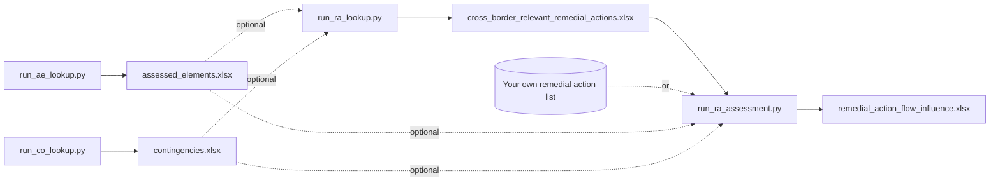

# Remedial action lookup jobs

The `remedial_action_lookup` folder holds four scripts. They build input lists from a CGMES model and assess remedial
actions with the `ImpactAssessment` engine. Each script reads its settings from a `.conf` file in the same folder, so
you change paths and options there rather than in the code.

| Job | Script | Settings file | Writes (default name) |
| --- | --- | --- | --- |
| Assessed element (AE) lookup | `run_ae_lookup.py` | `ae_lookup.conf` | `assessed_elements.xlsx` |
| Contingency (CO) lookup | `run_co_lookup.py` | `co_lookup.conf` | `contingencies.xlsx` |
| Remedial action (RA) lookup | `run_ra_lookup.py` | `ra_lookup.conf` | `cross_border_relevant_remedial_actions.xlsx` |
| RA impact assessment | `run_ra_assessment.py` | `ra_assessment.conf` | `remedial_action_flow_influence.xlsx` |

## How the jobs connect

The AE and CO lookups produce lists that the RA lookup and the RA assessment can use. Both of those jobs can also find
assessed elements and contingencies in the model on their own when no list is given. The RA lookup output can go
straight into the RA assessment.



Every job loads the same CGMES model zip (`MODEL_PATH`). Lists made from one model only match another model when the
element ids are the same, so build lists from the model you assess.

## Before you start

- Python 3.11 or newer.
- A clone of this repository with its dependencies installed. From the repository root, run `pip install -e .` (or
  `uv pip install -e .`, which uses the `rcc-pypi` index set in `pyproject.toml`).
- A CGMES model zip.

Run the scripts from a clone: each script finds its `.conf` file next to itself, and adds the repository root to the
import path, so it also runs from any other folder.

## Quick start

This example puts the model and all results in one working folder, `D:/ra_lookup`. Change the folder and file names
to your own.

**1. Set the model and output paths.** Edit these lines in the four `.conf` files in `remedial_action_lookup/`.
Leave the other lines as they are.

=== "ae_lookup.conf"

    ```ini
    MODEL_PATH=D:/ra_lookup/model.zip
    OUTPUT_PATH=D:/ra_lookup/assessed_elements.xlsx
    # empty: assessed elements of all countries, which the RA lookup needs
    ASSESSED_REGIONS=
    ```

=== "co_lookup.conf"

    ```ini
    MODEL_PATH=D:/ra_lookup/model.zip
    OUTPUT_PATH=D:/ra_lookup/contingencies.xlsx
    # contingencies of these countries only, empty for all
    CONTINGENCY_REGIONS=LT
    ```

=== "ra_lookup.conf"

    ```ini
    MODEL_PATH=D:/ra_lookup/model.zip
    ASSESSED_ELEMENT_LIST_PATH=D:/ra_lookup/assessed_elements.xlsx
    CONTINGENCY_LIST_PATH=D:/ra_lookup/contingencies.xlsx
    OUTPUT_PATH=D:/ra_lookup/cross_border_relevant_remedial_actions.xlsx
    ```

=== "ra_assessment.conf"

    ```ini
    MODEL_PATH=D:/ra_lookup/model.zip
    REMEDIAL_ACTION_LIST_PATH=D:/ra_lookup/cross_border_relevant_remedial_actions.xlsx
    CONTINGENCY_LIST_PATH=D:/ra_lookup/contingencies.xlsx
    ASSESSED_ELEMENT_LIST_PATH=D:/ra_lookup/assessed_elements.xlsx
    OUTPUT_PATH=D:/ra_lookup/remedial_action_flow_influence.xlsx
    ```

**2. Run the jobs in order** from the repository root. The same commands work in PowerShell and bash.

```bash
python remedial_action_lookup/run_ae_lookup.py
python remedial_action_lookup/run_co_lookup.py
python remedial_action_lookup/run_ra_lookup.py
python remedial_action_lookup/run_ra_assessment.py
```

Each job first logs `Job parameters: {...}`, which shows the settings it actually uses. Check these first if a
result looks wrong. A job checks that its input files exist when it starts. So run the AE and CO lookups before you
point the RA lookup at their output.

!!! tip "Shorter route"
    The RA lookup and the RA assessment can find assessed elements and contingencies in the model themselves. Leave
    `ASSESSED_ELEMENT_LIST_PATH` and `CONTINGENCY_LIST_PATH` empty in their `.conf` file and skip the AE and CO lookups.
    The separate lookups are useful when you want to review or edit the lists first.

## How settings work

### The `.conf` files

- One `NAME=value` per line. Lines starting with `#` are comments. Names are not case sensitive.
- **An empty value means the built-in default.** The defaults are listed in the tables in [Job reference](#job-reference).
- `MODEL_PATH` is required by every job, and `REMEDIAL_ACTION_LIST_PATH` by the RA assessment.
- The shipped files contain placeholders: `path_to_model`, `path_to_ae_list` and `path_to_co_list`. Replace each one
  with a real path, or empty it. Otherwise the job stops with `Path does not point to a file`.
- Lists are comma separated, for example `CONTINGENCY_REGIONS=LT,LV,EE`. Quotes are optional, so `'LT'` and `LT` are
  the same.
- Countries are two-letter codes as in the model, for example `LT`, `LV`, `EE`, `PL`.
- Yes/no settings take `True` or `False`.
- The `.conf` files are tracked in git. Keep your local paths out of commits, or set them with environment variables
  as described below.

### Paths

- **Relative paths resolve from the folder you run the command in**, not from `remedial_action_lookup/`. This applies
  to both input and output files. Absolute paths avoid surprises.
- Input files must exist when the job starts. The output folder must exist too. An existing output file is
  overwritten, and the file must not be open in Excel.
- On Windows, use forward slashes (`D:/ra_lookup/model.zip`) or unquoted backslashes (`D:\ra_lookup\model.zip`).
  Do not put a backslash path in double quotes: in `"D:\new\model.zip"`, the `\n` is read as a line break.

### Overriding with environment variables

An environment variable with the same name as a setting overrides the `.conf` value. This is handy for running the
whole chain on another model without editing four files:

=== "PowerShell"

    ```powershell
    $env:MODEL_PATH = "D:\ra_lookup\model_2.zip"
    python remedial_action_lookup/run_ae_lookup.py
    python remedial_action_lookup/run_co_lookup.py
    Remove-Item Env:MODEL_PATH
    ```

=== "bash"

    ```bash
    export MODEL_PATH=/data/ra_lookup/model_2.zip
    python remedial_action_lookup/run_ae_lookup.py
    python remedial_action_lookup/run_co_lookup.py
    unset MODEL_PATH
    ```

!!! warning
    - All four jobs share setting names such as `MODEL_PATH`, `OUTPUT_PATH` and `CONTINGENCY_LIST_PATH`. A variable
      set in your shell applies to every job you run until you remove it. Do not set `OUTPUT_PATH` this way, or each
      job overwrites the previous job's output.
    - An **empty** environment variable is ignored, so it cannot clear a `.conf` value. To make a job find elements
      in the model instead of reading a list, empty the path in the `.conf` file itself.

### CGMES import parameters

`CGMES_IMPORT_PARAMETERS` is passed to `pypowsybl.network.load()`. It decides which element ids the network gets.
Use the same value in every job that works on the same model, or the element ids in the lists will not match. Write
it as JSON on a single line, with every value in double quotes.

The shipped value suits the Baltic CGM:

```ini
CGMES_IMPORT_PARAMETERS={"iidm.import.cgmes.source-for-iidm-id": "rdfID", "iidm.import.cgmes.import-node-breaker-as-bus-breaker": "False"}
```

For a pan-EU CGM, use the commented-out alternative from the `.conf` files, joined onto one line:

```ini
CGMES_IMPORT_PARAMETERS={"iidm.import.cgmes.source-for-iidm-id": "rdfID", "iidm.import.cgmes.store-cgmes-model-as-network-extension": "true", "iidm.import.cgmes.create-active-power-control-extension": "true", "iidm.import.cgmes.post-processors": "EntsoeCategory"}
```

### Settings in every job

| Setting | Default | Description |
| --- | --- | --- |
| `MODEL_PATH` | required | CGMES model zip. |
| `MIN_NOMINAL_VOLTAGE_KV` | `330` | Lowest voltage level in kV for elements the job considers: `330` for the Baltic CCR, `400` for pan-EU. |
| `CGMES_IMPORT_PARAMETERS` | Baltic CGM value above | Pypowsybl CGMES import parameters, as JSON. |
| `LOG_LEVEL` | `INFO` | `DEBUG`, `INFO`, `WARNING` or `ERROR`. |

## Job reference

### Assessed element lookup: `run_ae_lookup.py`

Lists the assessed elements found in the model:

- lines at or above `MIN_NOMINAL_VOLTAGE_KV`
- transformers whose highest winding is at or above it
- each side of a tie line that is at or above it

Each tie line side is a separate element belonging to its own TSO.

| Setting | Default | Description |
| --- | --- | --- |
| `OUTPUT_PATH` | `assessed_elements.xlsx` | Output file. |
| `ASSESSED_REGIONS` | empty (all) | Countries to keep. The shipped file sets `'LT'`. |

**Output**: a single sheet with these columns:

- `name` and `grid_element_id`
- `eq_type`: `line`, `transformer` or `tieline`
- `secured_for_region`: the country
- `operator`: the TSO name for that country
- `registered_resource`: a new random id on every run

!!! tip
    The RA lookup only looks for influence on elements in this list. For a list you will use in the RA lookup, keep
    `ASSESSED_REGIONS` empty.

### Contingency lookup: `run_co_lookup.py`

Runs the initial load flow first, and stops if it does not converge. It then lists one ordinary N-1 contingency for
each element in service:

- lines, transformers and tie line sides at or above `MIN_NOMINAL_VOLTAGE_KV`
- generators of `GENERATOR_ENERGY_SOURCES` with a maximum active power of at least `MIN_GENERATOR_P_MW`, at any voltage
  level

An element counts as in service when current flows at each of its ends. Elements out of service are skipped, and the
log lists them.

| Setting | Default | Description |
| --- | --- | --- |
| `OUTPUT_PATH` | `contingencies.xlsx` | Output file. |
| `GENERATOR_ENERGY_SOURCES` | `THERMAL,NUCLEAR,HYDRO` | Any of `THERMAL`, `NUCLEAR`, `HYDRO`, `WIND`, `SOLAR`, `OTHER`. |
| `MIN_GENERATOR_P_MW` | `100` | Lowest generator maximum active power in MW. |
| `CONTINGENCY_REGIONS` | empty (all) | Countries to keep. The shipped file sets `'LT'`. |

**Output**: a single sheet with these columns:

- `registered_resource`
- `co_name`: `OCO_<element name>`
- `type`: `Ordinary`
- `area` and `operator`
- `grid_element_id` and `eq_name`
- `eq_type`: `ACLineSegment`, `PowerTransformer` or `SynchronousMachine`

### Remedial action lookup: `run_ra_lookup.py`

Finds the topological remedial actions that are cross-border relevant:

1. **Candidates.** Each line and transformer at or above `MIN_NOMINAL_VOLTAGE_KV`, in every country, becomes one
   candidate. The candidate opens the element if it is in service, and closes it if it is out of service. Tie lines are
   not candidates.
2. **Influence factors.** The job applies each candidate and solves the load flow, first in the base case and then,
   when `RUN_N1_FOR_RAS=True`, under each contingency. For every assessed element it then calculates
   `|I_after − I_before| / PATL × 100`. It uses the change in active power instead when the element's limit is not a
   current limit.
3. **Relevance.** A candidate is cross-border relevant when its influence factor on any element of a neighbouring TSO
   reaches `THRESHOLD_PERCENT`, in the base case or under any contingency. A neighbouring TSO is a country that shares a
   tie line with the candidate's country.

| Setting | Default | Description |
| --- | --- | --- |
| `ASSESSED_ELEMENT_LIST_PATH` | empty: find in model | AE list, for example from the AE lookup. When empty, the job finds the lines, transformers and tie line sides of all countries itself. |
| `CONTINGENCY_LIST_PATH` | empty: find in model | CO list, for example from the CO lookup. When empty, the job finds contingencies itself, using the settings below. |
| `OUTPUT_PATH` | `cross_border_relevant_remedial_actions.xlsx` | Output file. |
| `RUN_IF_ASSESSMENT_FOR_RAS` | `True` | `False` lists the candidates only, without influence factors. |
| `RUN_N1_FOR_RAS` | `True` | `False` assesses the base case only. |
| `THRESHOLD_PERCENT` | `5` | Influence factor threshold in percent. |
| `IGNORE_EMERGED_ISLANDS` | `True` | Keeps the results of candidates and contingencies that split off an island. |
| `GENERATOR_ENERGY_SOURCES` | `THERMAL,NUCLEAR,HYDRO` | Used only when the job finds contingencies itself. Same meaning as in the CO lookup. |
| `MIN_GENERATOR_P_MW` | `100` | Same as above. |
| `CONTINGENCY_REGIONS` | empty (all) | Same as above. The shipped file sets `'LT'`. |

What runs depends on the two `RUN_*` settings:

| `RUN_IF_ASSESSMENT_FOR_RAS` | `RUN_N1_FOR_RAS` | Calculation | Output sheets |
| --- | --- | --- | --- |
| `False` | any | Candidates only | `all` |
| `True` | `False` | Base case | `xra`, `all` |
| `True` | `True` | Base case and each contingency | `xra`, `all`, `contingencies` |

!!! note "Run time"
    An N-1 run solves one load flow per candidate per contingency, plus one per candidate for the base case. Try the
    settings with `RUN_N1_FOR_RAS=False` first. Then narrow the contingencies with `CONTINGENCY_REGIONS` or a shorter
    contingency list.

**Output sheets:**

- `xra`: cross-border relevant candidates only. This sheet comes first, so the RA assessment reads it.
- `all`: every candidate.
- `contingencies`: the contingencies that were used.

Each candidate row has the remedial action list columns: `type`, `registered_resource`, `ra_name` (`RA_<element
name>`), `region`, `operator`, `alt_type`, `alt_name`, `property`, `equipment`, `eq_type`, `normal_value` (`0` opens,
`1` closes), `direction` and `value_kind`. With influence factors, these columns are added:

- `impact_factor`: the highest influence factor on a neighbouring TSO, in percent
- `impacted_operator` and `impacted_element`: where that highest factor was found
- `impacted_contingency`: the case it occurred in, `BASE_CASE` or a contingency name
- `cross_border_relevant`

Candidates that diverged or could not be applied have an empty `impact_factor`.

Elements in the AE or CO list that are not in the model are skipped with a warning. A contingency is skipped whole
when any of its elements is missing.

### RA impact assessment: `run_ra_assessment.py`

Calculates the flow influence factor of each remedial action in a list on each assessed element. It does this in the
base case and under each contingency, with the same formula as the RA lookup. Use it to look at the detailed results
of the remedial actions the RA lookup selected, or of your own list.

| Setting | Default | Description |
| --- | --- | --- |
| `REMEDIAL_ACTION_LIST_PATH` | required | Remedial action list xlsx. The job reads the first sheet. |
| `REMEDIAL_ACTION_NAMES` | empty (all) | Comma-separated `ra_name` values to assess. |
| `CONTINGENCY_LIST_PATH` | empty: base case only | Contingency list xlsx. |
| `CONTINGENCY_NAMES` | empty (all) | Comma-separated `co_name` values to assess. |
| `ASSESSED_ELEMENT_LIST_PATH` | empty: find in model | AE list xlsx. When empty, the job finds the elements as the AE lookup does. |
| `ASSESSED_REGIONS` | empty (all) | Countries (`secured_for_region`) to keep. Applies to a list too. |
| `OUTPUT_PATH` | `remedial_action_flow_influence.xlsx` | Output file. |
| `THRESHOLD_PERCENT` | `5` | Sets `if_above_threshold`. Use a whole number. |
| `IGNORE_EMERGED_ISLANDS` | `True` | Keeps the results of remedial actions and contingencies that split off an island. |

You can use the RA lookup output as `REMEDIAL_ACTION_LIST_PATH`. Its first sheet is `xra`, or `all` when the lookup
ran with `RUN_IF_ASSESSMENT_FOR_RAS=False`. If `xra` is empty, there is nothing to assess.

**Output sheets:**

- `flow_influence`: one row per assessed element, remedial action and case. Its columns are:
    - `equipment`, `name` and `country`: the assessed element
    - `influencing_id` and `influencing_name`: the remedial action
    - `contingency_id` and `contingency_name`: `BASE_CASE` for the base case
    - flows before and after the remedial action: `i1_pre`, `i1_post`, `p1_pre`, `p1_post` and the same for side 2
    - permanent limits: `limit_t1`, `limit_t2`, `limit_type_t1` and `limit_type_t2`
    - influence factors in percent: `if_filtering1`, `if_filtering2`, `if_filtering_max` and `if_filtering_mean`
    - `if_above_threshold`: whether `if_filtering1` reaches `THRESHOLD_PERCENT`
- `assessed_elements`: the assessed elements used.

## Using your own lists

The lists follow the common list columns that the converters in `brcc_pypowsybl_helpers.converters` accept. Element ids
must be the ids that the model gets with your `CGMES_IMPORT_PARAMETERS`.

| List | Required columns | Notes |
| --- | --- | --- |
| Remedial actions | `type`, `registered_resource`, `ra_name`, `alt_type`, `property`, `equipment`, `normal_value` | Only `type` = `GridStateAlterationRemedialAction` with `alt_type` = `TopologyAction` and `property` = `ACDCTerminal.connected` is assessed. Power remedial actions (countertrade, redispatch) are skipped with a warning. |
| Contingencies | `registered_resource`, `co_name`, `type`, `grid_element_id` | Rows with the same `registered_resource` form one contingency. Rows with `normal_must_study` False are dropped, if the column exists. |
| Assessed elements | `registered_resource`, `name`, `grid_element_id` | `secured_for_region` is needed for `ASSESSED_REGIONS`. Rows with `normal_enabled` False are dropped, if the column exists. |

## Troubleshooting

| Message or symptom | Cause | Fix |
| --- | --- | --- |
| `Path does not point to a file` | A placeholder (`path_to_model`, ...) is still in the `.conf` file, a path is wrong, or a relative path resolves from a different folder. | Set an absolute path, or empty the setting. Check the `Job parameters` log line. |
| `Field required` for `model_path` or `remedial_action_list_path` | The required setting is empty. | Set it. |
| A setting ignores your `.conf` edit | An environment variable with the same name is set. | `Remove-Item Env:NAME` (PowerShell) or `unset NAME` (bash). |
| `Initial load flow did not converge` | The model does not solve with the shared load flow parameters. | Check the model and `CGMES_IMPORT_PARAMETERS`. |
| `None of assessed elements ... found in network model` or `None of contingencies ...` | The list was made from another model or with other import parameters. | Run the AE or CO lookup again on this model. |
| `PermissionError` when writing the output | The output file is open in Excel. | Close the file. |
| `Cannot save file into a non-existent directory` | The output folder does not exist. | Create the folder. |
| `Input should be a valid integer` in the RA assessment | `THRESHOLD_PERCENT` has a fractional value. | Use a whole number. |
| `Power remedial actions are not supported, skipped` | The list contains countertrade or redispatch actions. | Expected. Only topology actions are assessed. |
